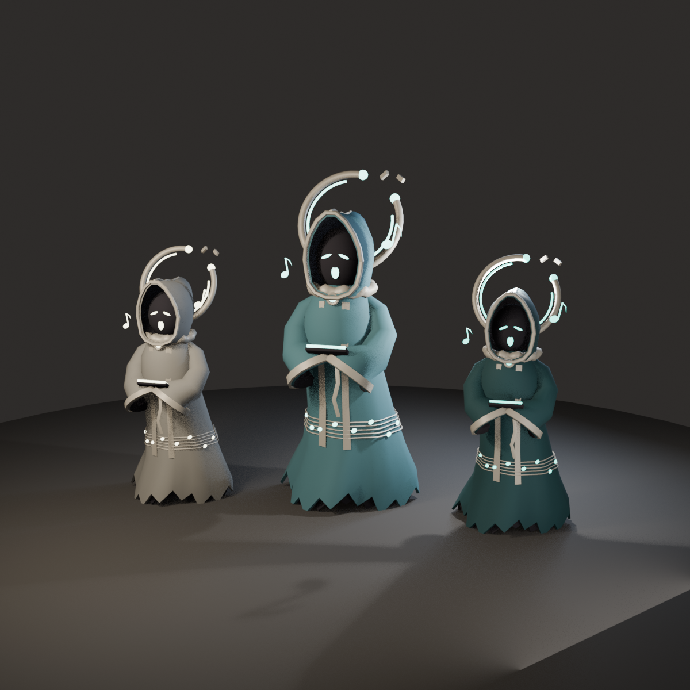
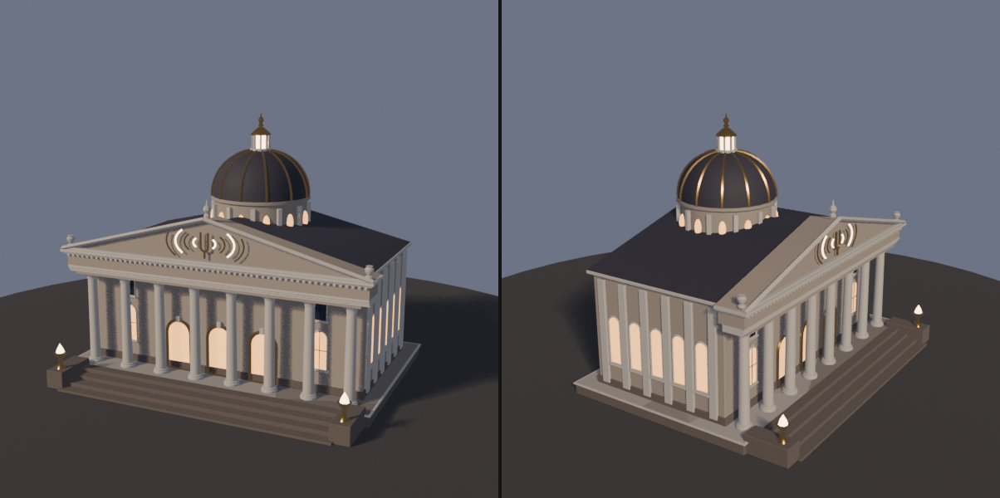
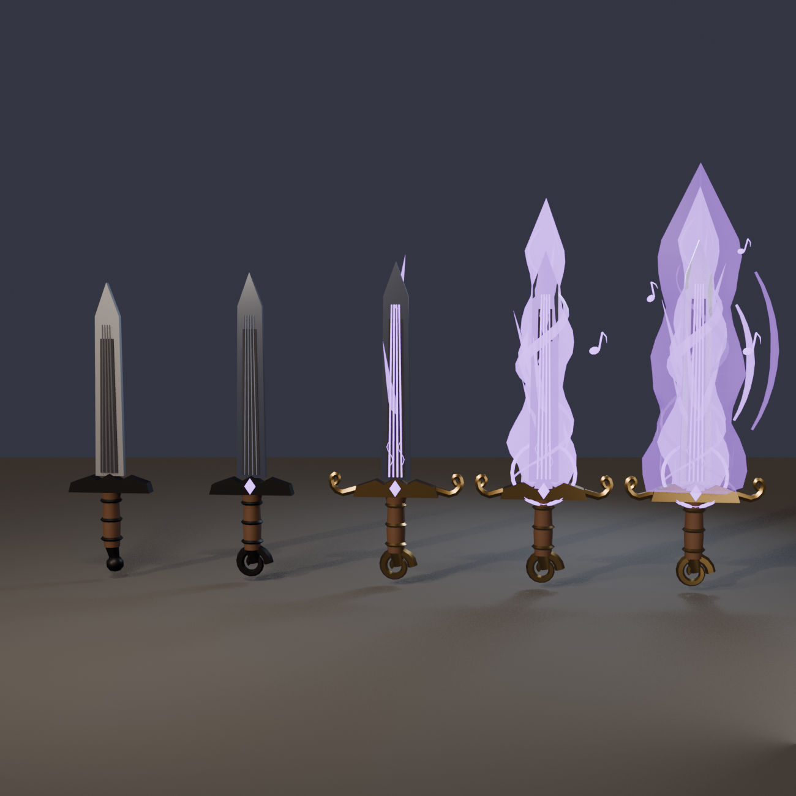

# Shattered Sky: the pitch

## Alone you’re a note. Together, a symphony.

**Shattered Sky** is a co-op turn-based RPG for Roblox. Form a squad, step into the rifts and fuse your attacks into Chords. Solo or with up to three friends.

## The world

Ten years ago, a sound tore the sky open. Out of the rifts fall the **Dissonants**, creatures made of corrupted sound. A few people tuned in to that sound and became **Resonants**.

Their city is **Vertex**, a stone concert-hall city at blue hour. At its heart stands the Vertex Fork, which reads every hunter’s attunement and ranks them in **Circles**, from VII up to I.

## Every attack is a note

- **Interval:** two different Tones in a row on the same enemy add damage.
- **Chord:** three Tones trigger a special effect that depends on the mix, and the chain plays a real musical chord.
- **Symphony:** four Tones and the whole squad lands one joint attack.

Fire and Ice make **Steam** and blind every enemy. Thunder and Impact make **Broken Resonance** and shatter the target’s guard. Void brings **Silence**. The squad plans at the same time, reads what each enemy intends to do, and agrees who strikes first with which Tone.

## Your squad: four seats, always

| | | |
|---|---|---|
| **Instrument** | your class | Strings strike hard, Percussion tanks, Keys hit areas, Voice heals and holds the wildcard Light |
| **Tone** | your element | Cut, Impact, Fire, Ice, Thunder, Void, Light: the notes you bring to every Chord |
| **Genre** | your sound | Metal, Classical, Jazz, Fado: matching genres gives squad bonuses and shifts the soundtrack |

Play solo and you control all four, your hero plus three recruited Companions. Bring friends and they take the seats. Same game, same balance, same rewards.

## One run, ten to fifteen minutes

**Vertex** (meet your friends) → **Guild** (form a squad, pick a rift) → **Rift** (fights, events, treasure, rest, a boss) → **Crescendo** (at every rest, vote: leave with the loot or go deeper for more) → **Haven** (upgrade your base, recruit Companions).

Going deeper makes enemies tougher and raises the rewards. Wipe, and the squad loses part of the loot.

## The look

A concert-hall city at blue hour: warm stone, brass and lamplight. Every model is made in Blender, low poly but flowing, and held to strict triangle budgets so it runs on phones.

## What you collect

Rifts drop gear in five tiers, from **Worn** to **Maestro**. The aura grows and moves with every tier, in the wielder’s Tone colour. Some drops are real instruments, one per class and Genre: a guitar-axe for Metal, a violin and bow for Classical, a double bass for Jazz, a Portuguese guitar for Fado. Characters play them in battle.

## Fair by design

Money buys cosmetics only: auras, Tone effects, Chord sounds. Never stats, techniques or ranks.

---

© All rights reserved.
